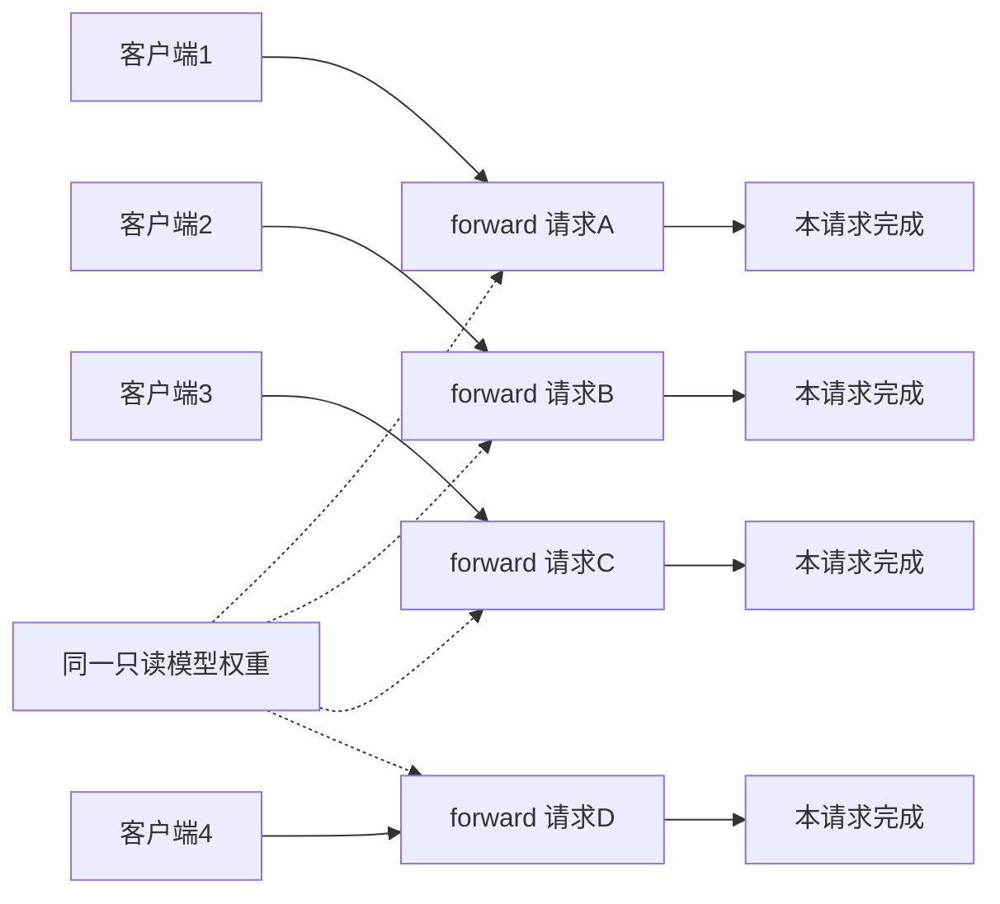

# 多客户端、完整 Eager forward 推理场景

[CPU与A3的实测结果](RESULTS.md)及[机器可读数据](evidence/results_20261115.json)已保存。
完整请求并发在本轮有吞吐收益；之前的Prepare原型补充组仍慢于同stream控制。

这次并行单位是**完整请求的 forward**。一个进程只加载一个只读 eval 模型，1/2/4个Python
客户端线程共享权重，每个客户端收到完成回执后才发下一个请求。没有模型大锁、没有跨请求
合批，也没有把一次forward的算子数当成请求数。



## 请求与完成语义

- 当前适配器执行完整原版DLRM：每请求batch128，26表、V1024、D16，底部/顶部MLP及
  Interaction全部执行，权重保持冻结。八种确定性请求保留MetaSyn26的ragged offsets/长度、
  重复ID模式及原始空表；通过ID模1024平移和dense行置换改变请求内容。请求0保留原始输入。
- 各客户端有物理独立的只读输入槽；输入转换、H2D和八份CPU参考值在计时前准备。
  固定请求ID0..2999、input_id=request_id%8，每种输入375次；总工作量不随客户端数增加。
- CPU eager操作完成后直接回执。NPU每客户端独立持有一个普通Event，严格按照
  `forward → event.record(current_stream) → event.synchronize → 下个请求`复用。
  当前PTA对每次record都先增加host待记录计数，只有consumer完成SDK record才清除；
  synchronize先等这个计数清空，再等待设备事件，避免等到上一轮旧record。
- NPU主场景每客户端独立stream；共享默认stream作为控制。现有Prepare队列只支持
  默认stream，mutex4/MPSC4补充组只能用shared，不能冒充private-stream对照。
- 请求循环里没有适配器发起的全设备synchronize。配置、预热后静止点、关闭时会同步；
  Prepare后端自身仍可能执行保守回退屏障，这部分保留在其测量成本内。

## GIL 与指标

同一个Python3.14.6t二进制、同一Torch2.13和固定CPU8–15，Torch intra/inter-op均1。
`giloff`使用解释器自然默认值；`gilon`仅加入`-X gil=1`，每次导入前后及运行结束检查真实状态。
这是**同一FT构建中的运行时GIL开关对照**，不等同于另一个标准GIL构建的比较。

每客户端预热24次，每性能窗口总请求3000。统计真正完成数/总墙钟的requests/s，以及
每请求从调用到完成的p50/p95/p99、host forward返回时间、调用线程CPU与TID。
分位数采用最近秩。每请求含128条样本，samples/s=128×requests/s。

Host forward区间重叠不证明Python字节码或NPU kernel同时执行；独立stream也只提供设备
重叠的条件。输出在计时后逐个与CPU参考比较，检查全部请求ID/形状/有限值、模型未修改。
不包含网络、请求解析、预处理或输出序列化，属于服务端模型执行核心的闭环负载回放。

## 文件与运行

`engine.py`与模型和Torch解耦：session factory在客户端线程进入上下文，
`session.forward(request_id)`执行请求，`session.complete(output)`确认完成。
`requests.py`生成不可变请求描述；`real_service.py`提供Torch适配；`contracts.py`及
`analyze.py`重算指标并拒绝少请求、错误GIL、错误设备、计数/关闭/映射不符等结果。

```text
python -m unittest discover -s test/forward_concurrency_r35 -v
python benchmarks/forward_concurrency_r35/campaign.py --device cpu --rounds 1 --plan-only --output NEW_PLAN
```

部署到匹配的FT环境后，使用结构化`launch.json`（argv_prefix结束于真正解释器，前面含
容器内timeout，controller只给gilon追加-Xgil=1）。config必须提供CPU列表、冻结模型路径、
文件/源码/解释器pins；NPU另需私有D894包和已审阅provider pins。

```text
python benchmarks/forward_concurrency_r35/campaign.py --device cpu --rounds 1 --launch launch-cpu.json --config CONTAINER_CONFIG --worker CONTAINER_REAL_SERVICE --container-output NEW_CONTAINER_OUTPUT --output NEW_HOST_OUTPUT --pull-results
python benchmarks/forward_concurrency_r35/analyze.py --campaign NEW_HOST_OUTPUT --output NEW_AUDIT.json
```

CPU完整矩阵是GIL开/关×客户端1/2/4。NPU完整矩阵还包含shared/private两种stream；
`--include-prepare`增加GILoff、4客户端、默认stream的mutex4和MPSC4。
若资源窗口只允许预先声明的子集，分别审计每份receipt并明确写subset，不能声称完成整个矩阵。

线程错误和超时会停止新请求并报告仍活跃的客户端。未获原生关闭ACK时保存失败记录后强制
终止该实验进程，避免带未知原生资源进入解释器清理；外层容器内timeout是最终边界。
任何被杀、少请求、数值或关闭失败的窗口都不能作为性能结果。
