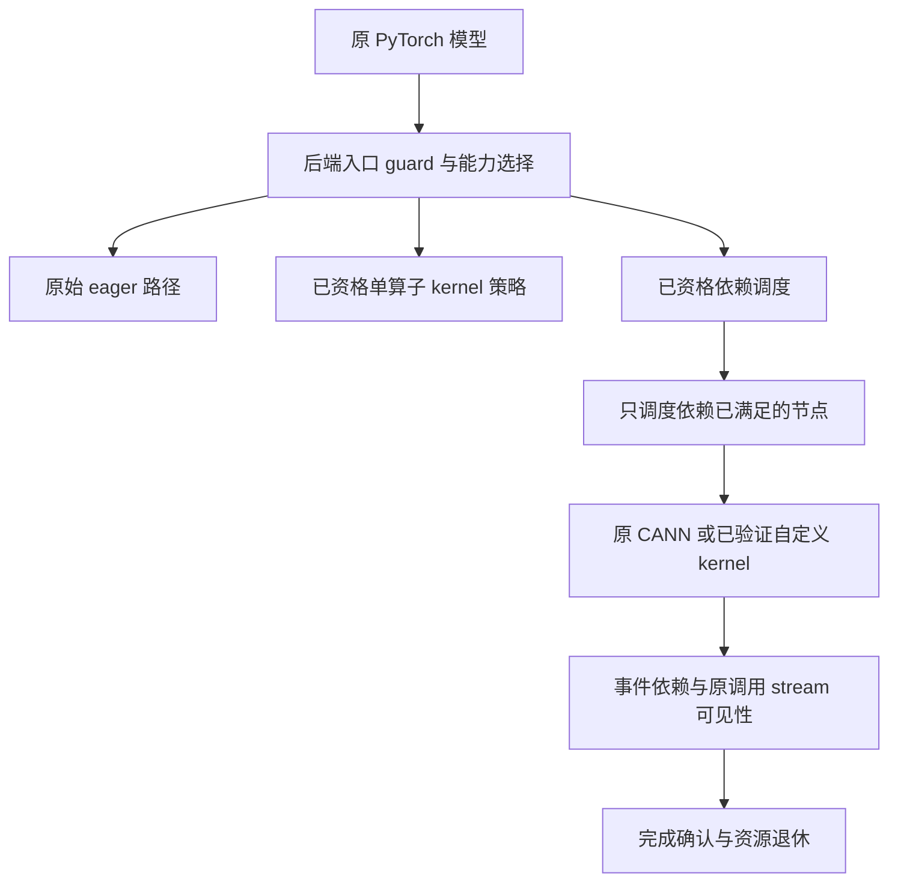

# R26：模型无感的 Eager NPU 并行设计

日期：2026-10-29（客户端时区 Asia/Singapore）。设计基线：`60246fe9a9fff2fc724bf9155f0f38fb4266b0bc`。
本交付为设计、改码地图和验收方案，尚未实现下述 R26 模块。

## 1. 目标与选择

模型继续调用原来的 PyTorch 算子，保留 `forward`、权重、输入与公开语义。
通用的是能力选择、依赖管理、生命周期、错误处理和测量框架；每个算子的
device kernel、效果描述和 SDK 资格仍需要适配与验证。不能承诺所有模型都有加速。

比较三个方向：

| 方向 | 优点 | 代价/边界 | 决策 |
| --- | --- | --- | --- |
| 优先优化单个算子的 device kernel | 模型不改；保持原 stream/FIFO；不新增 CPU worker | 需要真实 NPU、对应内核源码和访存分析 | 主路线，首先验证 |
| 通用依赖调度，多算子跨 stream 重叠 | 可服务不同模型的独立分支 | 需要完整 effect boundary、别名和跨 stream 生命周期 | 第二阶段，独立开关 |
| 多表/同族算子融合 | 减少 launch，可能改善访存 | 算子族专用；eager 聚合等待可能损害 latency | 有设备证据后再做 |

首版优化域为 Eager、推理/no-grad、原生 NPU Tensor、已资格化设备/SDK。
训练、RNG、有副作用 custom op、图捕获、通信、外部 stream/allocator 等未资格域
执行原路径。首个 kernel 域为 EmbeddingBag FP32/sum；表数、batch、embedding
维数和 bag 长度均为参数，生产路径不能写死 DLRM、26 张表或 128 batch。
FP16/BF16、mean/max、sample weights 和 backward 分别扩展资格，不混在首批提交。

## 2. 已知证据与设计依据

R25 在 host-sim 上确认了实际 native Prepare、原 FIFO 顺序及资源关闭，但 W1/W4
分别慢约 41%/68%。后续同候选容量对照中，8→32 后峰值只有 10–12，W4 没有
稳定改善；每 batch 主动上下文切换约为 off 85、W1 240、W4 716。
这些结果支持减少逐算子协调成本，不能代表真实 CANN kernel 或 Prepare 的成本。

R25 模拟 SDK 的 GetWorkspace/descriptor/Execute 共用 registry mutex，且只做
metadata bookkeeping、workspace=0。它证明协议，不证明真实设备计算或扩展性。
R26 的主路线不会默认叠加 R25 的 host Prepare worker 池。

## 3. 分层架构与独立开关



拟提供实验配置层 `torch_npu/_eager_parallel.py`，只负责选择已验证策略，
不 monkey-patch 模型。新开关默认为 off，旧 `_eager_prepare` 不改名冒充新能力。
以下为设计接口，不是当前可调用 API：

```python
with torch.inference_mode(), torch_npu._eager_parallel.scope(
    kernel_policy="qualified",       # off / qualified
    device_schedule="off",           # off / qualified；先 off
    host_prepare="off",              # off / qualified；默认 off
    grouped_fusion="off",            # 后期独立实验
):
    output = model(*inputs)            # 原 forward
```

正常退出 scope 必须 join 并确认所有资源退休；异常退出保留首个错误。
单算子 kernel 替换不改变调用 stream。跨算子模式允许独立节点物理重排，
保持 eager 的可观察结果和必需依赖；不能同时要求所有 device launch 严格全局 FIFO
又要求这些 launch 在不同 stream 重叠。R25 同流模式继续使用 FIFO hash 验证。

## 4. 第一优先级：单算子内核并行

先记录真实 SoC/driver/CANN/op-plugin revision、实际加载库、kernel 名称与设备
timeline。确认现有 vendor kernel 已怎样并行，区分 host launch、内核计算、
随机访存/带宽瓶颈。没有此基线，不以增加 CPU worker 或猜测 core 数代替优化。

EmbeddingBag 的候选策略：

1. 按 `(bag, embedding-dimension tile)` 分配互不重叠的输出 tile，每个 tile 独占写入。
2. tile 内连续读取 embedding 维度，合并访存；对尾部维度和空 bag 显式处理。
3. 短 bag 由一个工作单元完成归约；长 bag 仅在有实测收益时拆 partial sums，
   使用第二阶段固定归约合并，workspace 计入预算。
4. 不使用跨 block 自旋等待作为全局 barrier。双缓冲读/算/写必须有明确设备同步；
   尾部和空分片的控制流也必须满足 barrier 参与条件。
5. 固定 deterministic 模式下的分块与归约次序；定义外输入走原 kernel。
6. 四个输出的 shape/dtype/有定义内容都遵循实际 backend 合同，不能只实现主结果。

策略按 op schema、dtype/layout、shape/bag 分布桶、SoC、SDK、确定性设置选择。
先采用离线校准表与便宜查询，不在生产首次调用上执行两次模型做在线试错。
小 shape、没有稳定收益或实际带宽已饱和的域保留原 kernel。

CANN 的 device kernel 不在本 torch_npu 仓库。官方算子表列出了 EmbeddingBag 的
`op_kernel`、`op_host`、`op_api` 与 AI Core 交付件：
[CANN 算子列表](https://gitcode.com/cann/ops-nn/blob/master/docs/zh/op_list.md)。
外部改动区域是固定 revision 的 `<ops_nn_root>/index/embedding_bag/op_host/`
（tiling/策略）、`op_kernel/`（实际读取与归约）、`op_api/`（确有接口变更时才改）
及 `tests/`。此工作区未检出该完整 kernel 树；不得把其他架构子目录当成 910C 实现。
阶段 0 必须绑定实际 SoC 到可编译实现和 SDK 工具链；若开源实现不覆盖目标，
保留 vendor baseline，使用独立自定义 op 工程验证同一 schema，或停止 kernel 分支。

## 5. 通用运行时合同

新增模块集中于 `torch_npu/csrc/core/npu/eager_parallel/`，避免扩大既有巨型宏。

| 拟新增模块 | 责任 |
| --- | --- |
| `OperatorContract.{h,cpp}` | op/schema/SDK 资格、输入输出 effects、route 与 fallback reason |
| `EntryGuard.{h,cpp}` | 在 host metadata/data 读取前处理观察/变更边界；重入只建一个逻辑节点 |
| `FrozenCall.{h,cpp}` | 同次调用一次验证、捕获 metadata/TLS/config，并持有所需 allocation 保护 |
| `AllocationLease.{h,cpp}` | allocation ID/generation、地址保护、mutation fence 与退休 |
| `DependencyScheduler.{h,cpp}` | 单一状态所有者维护有界 DAG、RAW/WAR/WAW 与 ready 状态 |
| `CompletionTracker.{h,cpp}` | event 提交 ACK、完成观察、原 stream join、延迟释放 |
| `ExecutionAdapter.{h,cpp}` | 已资格 CANN/custom op 的 query/launch/cleanup；严格一次提交 |
| `Policy.{h,cpp}` | 根据已测域选择原路径、单 kernel、调度或融合；不识别模型类名 |

合同至少包括以下字段；这些是待实现类型的语义要求：

```text
OperatorContract:
  schema + backend route + SDK artifact profile
  qualified dtype/layout/shape/device domain
  input/output: metadata_read/write, data_read/write, alias/storage_replace
  host_observation, RNG, collective, graph_capture, autograd effects
  output_metadata_available_before_launch
  prepare_effect: MetadataOnly | NeedsDeviceData | Unknown
  concurrent_prepare_qualified; executor/thread/TLS/cache lifetime contract
  launch_stream_contract; workspace ownership; deterministic contract
  original-route adapter; terminal-error policy
```

注册名字不等于合格。未知 effect、未知 SDK 并发能力、value-dependent output shape
默认走原路径。`NeedsDeviceData` 的 Prepare 必须等待输入依赖完成，不能只因名字
叫 GetWorkspace 就提前执行。目标 stream 要在有 stream affinity 的 Prepare 前确定。

### 调用时快照与 allocation 保护

生产端保留最小的同步步骤：资格判定、取得资源保护、捕获本次 shape/stride/dtype/
地址/offset、调用 TLS 与逻辑序号。域判断与捕获共用一次验证结果，避免 R25
合格路径最多 14 次重复 Tensor 审计。深度检查缓存必须以 allocator/config epoch
和 allocation generation 失效；不能永久相信一个曾经合格的指针。

`c10::Storage` 强引用只保活 StorageImpl，不能阻止其 DataPtr 被 resize 替换。
首版策略是对 metadata/Storage mutation 入口先 join 相关在途访问，再执行原变更；
同时由 allocator 维护 `(allocation_id, generation)` 保护实际地址，直到所有相关
device completion。不同 Storage 包装同一地址、未知 allocator、无法证明的 alias
保守退回原路径。先用 allocation 全范围冲突，细粒度范围分析后置。

### 跨算子依赖与可见性

单个 scheduler owner 记录每个 allocation 的最近 writer 和 readers，建立 RAW、WAR、
WAW 边；共享只读输入不制造写依赖。主结果、所有辅助输出、workspace 都登记。
保留 logical sequence 与 exactly-once，physical order 只对独立节点放开。

进入内部调度域时先接入调用 stream 的已有前驱；内部 ready 节点等待其必要 events。
在 `.item()`、D2H、未知算子、显式 stream/event、用户同步、mutation、scope exit
等观察边界，把内部 frontier join 回原调用 stream；需要 host 值时必须等待 join
完成。不能只同步 default stream 而遗漏 side streams，也不能每 launch 都立即
全局 join，把独立节点重新串行化。

`record_stream` 解决分配复用时机，不替代数据依赖事件。R25 的 device0/default
stream、`stream_uses.empty()` 以及 Prepare/Execute 同 stream 条件保持冻结；
多 stream 是新合同，不能删除旧检查后继承其资格。

首版每并行域只接纳一个 caller；第二 caller 或未资格 TLS/stream 进入时，走
`DrainToBaseline`：停止新 admission，经 owner 通道完成 join 后恢复原路径。
不将“同一模型名称”当成线程安全证据。后续多 producer 需独立线性化合同。
本约束不是对用户原程序中无同步的跨线程 Tensor mutation 提供自动修复：
检测到共享域的第二 caller 后，新调用必须在读取/修改参与调度的 metadata 之前
等待 domain drain ACK；无法截获的原始 DataPtr/Storage 写入不在优化域内。

## 6. 线程同步正确性是硬门槛

主路线 K 不新增 CPU worker。设备调度 S 由一个 owner 管理可变 DAG、状态、
额度和退休表；P（host Prepare）只有实测收益且 SDK 并发资格通过后才启用。
外部 CANN 内部是否有锁无法由本项目承诺；不合格时保持 P=off。

| 必须成立的约束 | 设计与验证 |
| --- | --- |
| 无数据竞争 | owner 写状态；工作线程只读冻结记录；结果通过独立完成通道转交 |
| 无丢唤醒 | 任务与完成通道分离；明确 release/acquire 发布；通知必须具备持久状态/计数，覆盖检查空队列与入睡之间的竞态 |
| 无广播惊群 | 新任务只通知能接收它的 worker；ACK 不广播唤醒全部 worker；通知按批或状态变化合并 |
| 无锁等待环 | 不持 allocator/registry/scheduler 锁等待 worker、FIFO、event 或 Python；worker 不等待原消费队列 |
| 无提前回收 | Prepare 完成和 launch 返回均不代表 device complete；租约/event/workspace 在完成 ACK 后退休 |
| 无取消重放 | 已提交设备的任务取消后仍等待 completion；不得通过原路径再执行一次 |
| 无 ABA | allocation、pool slot、event 都带 generation；旧 ACK 不能释放新一代资源 |
| 无隐式无限等待 | owner 正常路径用完成查询/异步通知；必须阻塞的 SDK wait 放专门服务且不持锁；超时停止新 admission 并保留无法确认安全的资源 |

若 P 启用，使用有界独立 worker inbox 与 completion channel；单 producer 场景优先
SPSC，平台不支持时用同合同的局部锁实现。正确性先于“无锁”标签。第一版不强行
实现通用 MPMC；每个 Node 有唯一主所有者，worker 的借用必须以 ACK 结束。

S/P 模式的 owner 是一个专用 coordinator；K/O 不创建该线程。数据入口为单 caller
到 coordinator 的有界通道，每个 Prepare worker 的 inbox/completion 各为独立通道。
caller 发布冻结描述后保持资源所有权，直到收到 registration ACK，才允许返还
eager 输出对象；ACK 是主机登记完成，不是等待 device complete。allocator 的短期
注册/租约操作在持其自身锁时完成，返回后才发布消息或等待 ACK，杜绝锁跨等待。
第二 caller 的 drain/close 请求走独立低频控制通道，允许局部 mutex 保护；绝不
从第二 producer 写入 SPSC 数据队列。coordinator 等待容量时仍必须处理 completion/
close/control，不能因 admission 满而停止回收。若专用 coordinator/ACK 开销无法过
性能门槛，S/P 不晋级，K 仍可独立发布。

线性化点明确：注册成功由 coordinator 持久记录 `(node_id, generation, effects)`
并发出 ACK；cancel 与 launch 都由同一 owner 顺序决策；设备提交成功由适配器保存
submission receipt；只有 completion 和全部 CPU 借用均确认，才发布 retired ACK
并归还额度。close 会冻结最后可接纳序号，后到 submit 获得拒绝，先到 submit 必须
有完成/取消/隔离结果。通知携带持久谓词或计数，测试必须覆盖“通知早于 waiter
入睡”“完成早于 registration ACK 消费”和“close 与最后一个 submit”三个窗口。

节点状态协议：

```text
Captured -> Preparing -> Prepared -> LaunchReady -> Submitted
         -> DeviceComplete -> Retired
未提交的失败/取消 -> 等全部 CPU 借用 ACK -> Cancelled -> Retired
已提交且完成未知 -> Quarantined（禁止新 admission，保留资源和首错）
```

event 池按 device/Context/domain 分开，完成 ACK 前不复用；申请失败应在 launch 前
阻止提交。实际 launch 后才遇到事件失败，进入 quarantine。不能为了让 gauge=0
强行释放。确定依赖同步是必要机制，不能承诺“完全没有同步”；发布要求是协议的
不变量成立，且量到的同步开销未使已选域退化。

## 7. 必须修改的现有代码区域

以下路径相对本仓库，均已在基线检查；新模块见上表。

| 代码区域 | 计划改动 |
| --- | --- |
| `torchnpugen/utils.py`：`gen_unstructured` | wrapper 入口 guard 放在 device/unsafe/overlap/host-meta 检查前 |
| `torchnpugen/gen_backend_stubs.py`：structured `sig_body` | 在 `op.meta(...)` 和检查前建立 boundary，而不只围住 `op.impl(...)` |
| `torchnpugen/custom_functions.py`：`METHOD_DEFINITION` | custom 入口覆盖与重入令牌；未知 effect 先 join |
| `third_party/op-plugin/torchnpugen/gen.py`：`gen_return` | direct/internal 转发路径在 FormatHelper 等读之前覆盖；避免重复节点 |
| `third_party/op-plugin/op_plugin/ops/opapi/EmbeddingBagNpuOpApi.cpp` | 保持 schema/四输出/原 fallback，增加已资格 kernel route 选择；不改模型 |
| `third_party/op-plugin/op_plugin/utils/op_api_common.{h,cpp}` 与 `op_api_common_base.h` | 新执行适配器及 SYNC/EXT/NO_FORMAT 路径覆盖；未知路径保持原实现 |
| `torch_npu/csrc/aten/VariableFallbackKernel.cpp` | CPU/unsupported fallback 前完成必要可见性边界 |
| `torch_npu/csrc/aten/common/ResizeNpu.h`、`ResizeNpu.cpp`、`SetNpu.cpp` | metadata/storage/data pointer 变更前的 mutation fence 与 generation |
| `torch_npu/csrc/aten/common/LocalScalarDenseNpu.cpp`、`torch_npu/csrc/aten/ops/op_api/CopyKernelOpApi.cpp` | host observation / D2H 的 join；legacy/其他 copy 入口纳入覆盖清单 |
| `torch_npu/csrc/core/npu/NPUCachingAllocator.{h,cpp}` | 新 allocation lease/generation 与多 stream 使用/退休接口 |
| `torch_npu/csrc/core/npu/NPUStream.{h,cpp}`、`NPUEvent.{h,cpp}`、`StreamAndEventKernelNpu.cpp` | 显式目标 stream、record 提交 ACK、wait/join 与观察边界 |
| `torch_npu/csrc/npu/Module.cpp`、`CMakeLists.txt`、`setup.py` | 实验配置、状态/诊断接口、分层 build flags，全部默认 off |

当前 checkout 的 op-plugin 子模块仍是原始文件；R25 实际 hook 位于
`patches/eager_prepare_r25/`，不能混称。新实现采用 `patches/eager_parallel_r26/`
与新 installer，或在独立 op-plugin 分支提交并固定子模块 revision；不修改冻结
R24/R25 payload。只改 generator 也不够：manual/foreach/special/custom 注册和
所有 mutation/observation 入口必须有覆盖清单；覆盖不完整时 S 不允许启用。

## 8. 测试与验收

### 三类环境的职责

| 环境 | 能证明什么 | 不作为哪类证据 |
| --- | --- | --- |
| CPU oracle / 独立 C++ runtime fixture | 数值参考、合同、调度状态机、错误/生命周期协议 | 真实 NPU 内核正确或快 |
| host-sim | 真实框架接入、来源/顺序、线程交接、资源关闭；可控 fake event 检查重叠与依赖 | NoOp 数值、CANN 性能/线程安全、设备带宽 |
| 真 NPU | 主/辅助输出合同、真实异步生命周期、device timeline、端到端收益 | 未测设备/SDK/shape 的普遍加速 |

#### 数值与语义

- 主输出：固定 CPU 算子与小规模显式 FP64 bag-sum oracle，另比同 SoC/SDK 的 eager-off。
- 四输出：全部检查 shape/dtype/device；有定义内容按合同比较，未定义 buffer 不读不比。
  辅助 shape 按 mode/include_last_offset/SoC 分支记录；训练扩展必须跑 backward 消费。
- 覆盖空/连续空/全 padding、重复索引、热点和随机索引、尾部非对齐维度、长短 bag、
  `None`/C++ engaged-undefined/defined-empty optional、错误 indices/offsets/sample weights。
- 初始 FP32、有限输入 [-1,1]、bag 长度≤64：主输出预设 `rtol=1e-4, atol=1e-5`；
  长 bag 用 FP64 oracle 与预声明累加误差界校验，并记录 baseline 误差，失败不临时放宽。
  NaN/Inf 单独核对语义；其他 dtype 在资格表中另定阈值。确定性模式重复运行须满足
  baseline 的确定性/报错合同，不能用平均正确掩盖竞态。

#### 同步与生命周期

- 独立分支、共享只读 weight、RAW/WAR/WAW、diamond/join、alias/view/as_strided、
  in-place/out、resize/set_/storage resize、地址复用、跨 stream 生产消费。
- `.item()`、CPU copy、非零值决定 shape、显式 events/streams/synchronize、未知 op、
  RNG/autograd/collective fallback；固定 RNG 状态后核对后续随机序列未被额外消费。
- 用 latch/barrier 控制故障与乱序：Prepare/launch/event record/query/wait/destroy 失败、
  cancel/close/submit 交错、额度耗尽、worker 早退出、晚 ACK/ABA。
- 独立 C++ core 跑 TSan/ASan；未 instrument 的 vendor SDK 不被称为已通过 TSan。
  有限状态枚举覆盖小容量、2 worker 的所有关键 interleaving；再做固定种子压力测试。
  每个 hang 有 watchdog、线程状态和首错；不能用 timeout 后杀进程当正常通过。

#### 性能隔离

| 模式 | 固定项与改变项 |
| --- | --- |
| O | 同候选二进制全部优化 off，原 CANN kernel |
| K | 只改变已资格单 kernel 策略，同 stream 顺序执行 |
| P | 只改变 host Prepare，device kernel/顺序保持基线 |
| S | 原 kernel，只改变已资格跨算子 device 调度 |
| F | 只启用已资格 grouped fusion；记录等待窗口与 flush 原因 |
| 组合 | 单项通过后才评估，不能用融合收益掩盖 scheduler 退化 |

正式性能不启 profiler/详细 trace，startup/warmup 分列；CPU wall 从原模型调用至
所有必要设备工作完成，另记 process CPU、context switches、峰值内存/workspace。
device events 的 end 位于全部 side streams join 后；不把 kernel 时长之和叫 makespan。
证明跨算子并行需要真实 device kernel 区间重叠；多个 worker/stream ID 不够。
单 kernel 多核并行看实际 kernel/tiling/core 使用与设备耗时；不能用 host TID 证明。

小筛选沿用 3 个配对 fresh-process round；候选晋级后跑 10 个平衡/随机化配对 round，
每进程≥200 样本且计时窗≥2秒，样本数由独立 pilot 预先固定；不混 cold/profiler 数据。
以进程为独立单位，报告每轮 ratio、median/p95、配对区间与 CPU/内存成本。
建议工程门槛：选定域 median 改善≥5%、10轮至少8轮方向一致、95%配对区间支持收益；
负例/control 域及 p95 回退≤3%。噪声达该量级则不能判通过。它们是晋级门槛，非承诺。

测试模型固定源码/权重/输入，不改 forward：原 DLRM；多分支 MLP；标准 CNN/ResNet；
标准 Transformer。外加严格串行链、大 GEMM/带宽饱和、频繁 sync、alias/in-place
负例。分开报告“正确支持运行”“有优化域命中”“有设备重叠”“端到端加速”。

## 9. 分阶段交付与停止规则

1. **R26-A 基线与单 kernel**：真实资格/数值/设备计时，优化 EmbeddingBag kernel，
   模型和原 stream 不变。这是首先争取收益且最少新增主机同步的路径。
2. **R26-B 通用边界与 host 成本**：effect registry、入口覆盖、lease/mutation、serial
   shadow DAG；合并验证、任务/event pool、分离通知。先把 W1 与 O 的开销差压到门槛内。
3. **R26-C 两条内部 stream**：完成新生命周期合同后，仅已证明独立的节点并行；
   无依赖宽度或带宽已满就选原路径，逐算子扩域，不按模型名特判。
4. **R26-D 多表融合**：仅同族独立 ready 节点、保留输出映射；默认不等待未来未知
   eager 调用。任何 batching 等待预算必须单独实验并在观察边界 flush。

数值错误、竞态、缺依赖、重复提交、提前释放、丢唤醒/死锁、不能确认 completion、
或未资格 SDK 一律阻断对应模式。P/B 未通过不妨碍 K 单独验证；没有真 NPU 时完成
CPU/hostsim 合同与工具，真实 kernel 和设备调度保持未资格。代码、证据和默认开关
不能把“待真机验证”改写成“已保证没有同步问题”。
