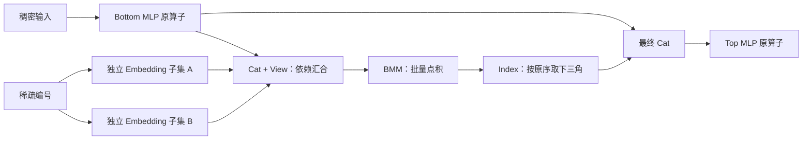

# R26 补充设计：PTA 层联合优化 Embedding 与 Interaction

本次范围按用户后续要求收敛：**模型 forward 不改，第一阶段只改 PTA/op-plugin，
复用已经安装并资格化的 CANN 算子；以 Embedding→Interaction→Top MLP 的整段收益验收。**
单 kernel 改造与自定义融合 kernel 保留为后续独立选项，不是首版前提。
本文件优先于前版“先改 CANN kernel”的实施顺序；通用同步/内存/测试合同仍适用。

## 1. 原始模型实际在执行什么

已核对原始 `dlrm_s_pytorch.py`，SHA256
`9d430a06b378ee02266a623d219c14c642b96283648831d2f998f251c244f5d5`。
`sequential_forward` 依次调用 bottom MLP、`apply_emb`、`interact_features` 和 top MLP；
`interact_features` 不是一个现成的单独 Interaction kernel，而是以下算子组合：

```python
T = torch.cat([x] + ly, dim=1).view(batch_size, -1, d)
Z = torch.bmm(T, torch.transpose(T, 1, 2))
Zflat = Z[:, li, lj]
R = torch.cat([x, Zflat], dim=1)
```

原配置 B=128、26 张表、D=16、无 self-interaction：

| 数据 | 形状/语义 | FP32 字节数 |
| --- | --- | ---: |
| dense feature x | `[128,16]`，底层 MLP 输出 | 8192 |
| 每张表的 embedding | `[128,16]` | 8192 |
| T | `[128,27,16]`，x 在第0个位置，其余按表的原顺序排列 | 221184 |
| Z | `[128,27,27]`，每个样本的 Gram 矩阵 | 373248 |
| Zflat | `[128,351]`，严格下三角，按原 li/lj 顺序 | 179712 |
| R | `[128,367]`，16维 dense + 351维交互 | 187904 |

这只是张量逻辑大小，不能当作实测 DRAM 流量；格式转换、读写、cache 和 workspace
会改变实际流量。该 BMM 按每个乘加计2次运算，约 2,985,984 FLOPs；不能仅因算子
名含 MatMul 就假定它是计算密集瓶颈。设备计时与 launch/拷贝开销需实测。

26 张表是这个验收模型的参数，运行时规则仍支持任意已资格的表数/维度/shape。

## 2. 第一版的联合执行方式



1. 用原 caller 提交算子；首版不再额外启用 host Prepare worker 池。
   host 提交可保持原逻辑顺序；设备执行由 stream 顺序与跨流 event 依赖决定，
   不需要以打乱 host 调用顺序为并发前提。
2. 从两条内部 NPU stream 开始调度独立 Embedding。底层 MLP 在已有异步路径上提交后，
   如没有必要的 host 等待，可与后续 Embedding 重叠；不声称把 Python 未来调用提前执行。
   side stream 只等待实际 weight/indices/offsets 的 writer frontier；不能每次无差别
   等待 S0 当前 tail，否则会把 bottom MLP 重新串在 Embedding 前。未跟踪的域前输入
   先在 scope 入口接入已确认的前驱；不能假定数据早已就绪。
3. 第一个 Cat 要读取 x 和所有 embedding，是自然的 fan-in。它等待各输入所属 stream
   的必要完成 event，再执行原 Cat kernel。已资格情况下采用 device stream wait，
   不在 CPU 上逐表 `synchronize`。
4. 同一 stream 上一组输入可用覆盖它们的尾 event 合并依赖；record 必须实际提交后，
   消费者 wait 才算可用。event 的复用、错误、资源退休仍按 generation/ACK 合同处理。
   现有 `NPUEvent::block` 某些队列模式会在 host 等待 record 出队；需要有界的
   publication handshake，而不是承诺零 host 等待。它不得等待设备计算完成，
   不持共享锁，且不能阻塞发布该 record 的同一执行者。
5. Cat/View/Transpose/BMM/Index/最终 Cat 优先保持在一个消费 stream，按数据依赖执行。
   这些算子的 kernel 内并行复用现有 CANN 实现。Top MLP 通过 R 的依赖继续执行。
6. 只有结果被 host 观察、遇到未资格 op/stream/mutation、用户同步或 scope 结束，
   才做必要的 host join；不能把“没有 Python sleep”误当没有同步成本。

同一个 batch 的完整 Interaction 需要全部输入准备好，不能让整个 BMM 与尚未完成
的输入查表无条件并行。进一步按到达顺序计算部分交互，意味着拆 BMM/引入分组归约，
可能制造大量小 launch；首版不采用。尤其不能把 351 对交互拆成 351 次独立提交。

整体性能观察：

```text
Top MLP 可用时间 = 最后一个输入可用时间 + 汇合/布局成本 + Interaction 链完成时间
```

以上是依赖路径关系，不表示各项可由 CPU 函数时长直接相加。Embedding 和 dense
重叠时，它们对关键路径的贡献主要由较晚完成的分支决定；两个阶段必须一起优化。

## 3. PTA 首版具体做什么

### 3.1 通用规则，不识别模型类/函数名

能力注册覆盖整个关键链，避免每遇到 Interaction 或 MLP 算子就触发全域 fallback：

| 类别 | effects/依赖合同 |
| --- | --- |
| EmbeddingBag | weight/indices/offsets 只读；主与辅助输出独立写；完整参数/四输出合同 |
| Linear/Addmm/Relu/Sigmoid 等实际 MLP 路由 | 依实际 trace 确认读写与临时 buffer；未知变体正常回退 |
| Cat | 读取原 TensorList 全部输入，按原次序创建新输出；fan-in 只依赖相关前驱 |
| View/Reshape/Transpose | 记录 alias/shape/stride；是否产生 copy 由实际路由确定，不能都当零成本 |
| Bmm | 两输入只读，输出写；T 与 transpose(T) 共享只读分配可并存 |
| Index | 读取 Z 与索引值；CPU 索引、搬运/转换和动态形状纳入 effects |
| Copy/host observation | H2D/D2H 与 host lifetime、可见性边界；不能遗漏异步 copy |

注册不是静态 schema 猜测：每个 backend route 及 CANN 资格都要独立证明。
未知 route 在**入口 host 读前**先完成必要依赖，再执行原路径，不静默越过。
已资格 metadata-only 入口不应每次无条件 drain 整个域。

### 3.2 首版保留合法张量布局，减少额外包装成本

保留每个 EmbeddingBag 的真实输出与四输出语义，保留原 Cat、BMM、Index 的结果。
优先减少重复资格检查、临时描述符/容器分配和不必要的 host wait。stride/transpose
由原 API 表达；只有数值、layout 和实际路由证明可以避免复制，才删除该复制。
不能因为 `T.transpose` 在 Python 是 view 就保证底层 CANN 从不做格式转换。

**不把“所有 embedding 直接写入未来 Cat buffer”列为透明 eager 首版功能。**
执行第一个 Embedding 时，运行时还不知道未来是否 Cat、列表顺序、是否多消费者或
alias/mutation；Cat 的 tensor stride/连续性与普通独立输出也不同。这样重定向输出
需要额外的有界区域记录、escape 检测和物化合同，不能只靠换一个 output pointer。

### 3.3 Python 索引构造是 PTA-only 的明确边界

原模型每次 forward 用 Python 循环和 `torch.tensor` 构造 li/lj，再索引 Z。
模型保持原样时，PTA 不能透明消除已经发生的 Python 循环/CPU tensor 构造。
这些时间继续计入端到端测量；不能把模型外预计算 li/lj 的结果称为无改模型收益。
backend 后续可研究索引搬运/转换缓存，但必须校验内容与变更，不能只按 shape 或
data pointer 缓存。若该部分成为主瓶颈，应报告 PTA-only 收益上限。

## 4. 第二版才考虑的联合物化/融合

仅在首版真实设备证据证明 Cat/格式转换/小 launch 占主导时考虑：

- 识别已经捕获的同族独立 producer→Cat→Bmm→Index 结构，而非 DLRM 类名。
- 输出可逃逸、alias、原地写、value-dependent shape、host 读或不支持 route 时立即
  按原语义物化；不能先发生副作用再回退重跑。
- 若现有 CANN 已有语义匹配的 fused Interaction 接口，先验证实际符号/SoC/数值/
  辅助语义后由 PTA 选择；当前设计不假定这个接口存在。
- 若没有现成融合接口，PTA 仅调用多个已有 kernel 无法承诺消除它们之间所有中间
  访存；新增真正 fused kernel 属于可选的 CANN/custom-op 分支。
- 非预测性 eager 首版只分组已经 ready 的调用，不为了等待未来表调用制造无限窗口。
  图重写或区域记录是单独模式，不能与纯在线调度的收益混报。

## 5. 具体改码位置

下列均为现有路径或明确标注的拟新增文件；op-plugin 修改通过新 R26 overlay 或
独立子模块 revision 落地，冻结 R25。

| 文件/模块 | 联合优化改动 |
| --- | --- |
| `torchnpugen/utils.py`、`gen_backend_stubs.py`、`custom_functions.py` | 所有相关算子 host 读前的入口 effects；重入与原路径 fallback |
| `third_party/op-plugin/torchnpugen/gen.py` | direct/internal 调用边界、避免重复节点 |
| `third_party/op-plugin/op_plugin/ops/opapi/EmbeddingBagNpuOpApi.cpp` | 已资格提交 adapter，保留全部输出；不写死表数 |
| 同目录 `CatKernelNpuOpApi.cpp` | TensorList 全读集合、输入顺序与 fan-in、别名/输出合同 |
| 同目录 `BmmKernelNpuOpApi.cpp` | 实际 BatchMatMul/Matmul route、transpose/非连续 layout、dtype/数学模式 |
| 同目录 `IndexKernelNpuOpApi.cpp`、`ReshapeKernelNpuOpApi.cpp` | 索引依赖、host/device 索引路径、view/copy 与输出 shape |
| `third_party/op-plugin/op_plugin/utils/AdvancedIndex.cpp` | CPU li/lj 的 `.to(self.device())` 为独立 H2D effect；bool/byte→Nonzero 及数据依赖 shape 单独回退 |
| `torch_npu/csrc/aten/common/TensorShape.cpp` 及实际 view/transpose 注册 | alias 关系与 metadata 修改保护，按生成覆盖清单定位所有入口 |
| 拟新增 `eager_parallel/OperatorContract`、`FrozenCall`、`AllocationLease` | 整链能力表、一次验证、真实分配地址保活 |
| 拟新增 `eager_parallel/DependencyScheduler`、`CompletionTracker` | independent producer 分流、Cat fan-in、interaction 连续消费、退休 |
| `NPUStream.cpp`、`NPUEvent.cpp`、`NPUCachingAllocator.cpp` | stream/event ACK 与多流内存生命周期；不删旧 R25 安全条件 |

`transpose.int`、`slice.Tensor` 的实际 dispatcher 路径要在目标构建 trace 中确认；
不能用 custom `npu_transpose` 的物理搬运实现代替普通 transpose view 的别名合同。

## 6. 同步正确性与联合测试

同步硬约束沿用主规格，补充整链测试：

1. Embedding 按随机顺序完成，Cat 仍严格按原 tensor list 顺序组合。较晚完成的
   一张表不应阻塞其他独立表执行，但必须阻止消费其值的 Cat/BMM。
2. x 同时用于第一个 Cat 和最终 Cat，租约覆盖两次读取；T 与 transpose(T) 的
   read/read alias 合法，不能因共享内存而制造错误写依赖或提前释放。
3. index 输出按原 li/lj 顺序，不能只比较无序数值集合；测试 self-interaction=true、
   cat interaction 与未知模式回退，不能错误套用 351/367。
4. 任意一表失败、event record 尚未提交、取消/close、末表完成晚于其他表，
   都必须保留首错、禁止下游提前消费、完成确认前不回收。
5. 插入用户 `.item()`、D2H、显式 stream、`resize_/set_`、第二消费者，验证
   host 可见性与有序 fallback。no-grad 外训练路径正确回原实现并验证梯度。
6. 通用参数：表数 1/2/7/26/39，D=8/16/31/64/128，短长/空 bag，batch 可变。
   较宽表数的 N² 交互及已饱和访存作为负例，策略不能盲目增加 stream。

FP32 联合数值门槛独立声明，不直接把 bag-sum 的阈值套给全模型：首先记录并固定
Matmul precision、TF32/混合精度、确定性与 autocast 设置；各臂完全一致。初始有限
输入域相对同设备 eager-off：Embedding 用 `rtol=1e-4, atol=1e-5`，BMM/Interaction
用 `rtol=1e-4, atol=1e-4`，最终模型输出用 `rtol=1e-4, atol=1e-5`。CPU FP64 小例
另检查主结果与点积数学参考，并报告误差传播；阈值是待实现测试的预设门槛，不是
当前精度证明。长 bag、低精度、溢出与 NaN/Inf 单独设域；任何实际失败先定位，
不能跑完后临时放宽阈值让候选通过。确定性模式额外要求多次运行的既定确定性合同。

新增测试文件建议：

- `test/eager_parallel/test_feature_interaction_reference.py`：CPU 的 Embedding+
  Gram/下三角/最终 Cat reference 与结果顺序。
- `test/cpp/eager_parallel/fan_in_test.cpp`：可控完成顺序、read/read alias、
  event 提交 ACK、late error、输出多消费者、资源退休。
- `test/npu/test_eager_parallel_feature_pipeline.py`：原模型数值和实际多 stream
  生命周期；独立诊断 profile 检查消费者没有提前执行。
- `benchmarks/eager_parallel_r26/feature_pipeline.py`：同模型/同 SDK 的整段和全模型比较。

## 7. 性能归因与晋级

首版使用同一个候选、同 CANN 算子、同原模型输入/权重，比较：

| 臂 | 变化 |
| --- | --- |
| O | 原完整 eager 路径 |
| B | 新运行时串行模式，检查接入成本 |
| E | 只允许独立 Embedding 跨 stream；其余正确 join 后原路径 |
| EI | Embedding 分流＋已资格 Interaction 整链依赖/单消费流；没有 host Prepare 池 |

这样能区分 Embedding 分流收益、整链减少过度 fence 的收益和接入开销。临界路径
指标是 x/各表最后就绪时刻、Cat 开始/结束、BMM、Index、最终 Cat、Top MLP 完成；
详细 trace 在独立诊断进程，正式性能以原 forward→完整同步计时。
不要把重叠阶段的 CPU 时长或 kernel duration 直接求和当全模型耗时。

真正的晋级要求同时报告：Embedding、Embedding+Interaction、完整模型 median/p95，
process CPU、context switches、峰值内存、fallback/host sync次数、device overlap。
Embedding 局部快但 EI 或整模型慢，不晋级。默认两条内部 stream，只有真实证据支持
才比较更多流；若带宽竞争抵消收益，自动保留单流资格策略。

CPU/host-sim 用于 reference、依赖和回收；真实 NPU 才用于查表/求和/Interaction
数值和速度。原 R25 NoOp 不执行真实 BMM/索引数值，不能从其阶段耗时推断实际
Interaction 是快还是慢。此轮仅设计修订，没有声称完成上述实现或测试。
